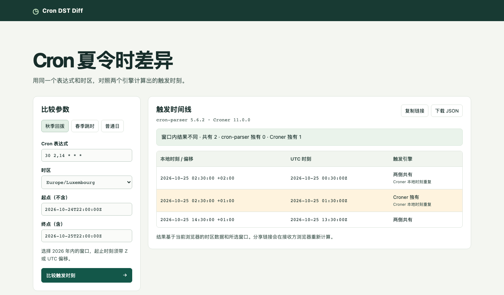

# Cron DST Diff · Cron 夏令时差异

同一个 Cron 表达式，在夏令时回拨当天会触发几次？这个浏览器工具用 **cron-parser 5.6.2** 和 **Croner 11.0.0** 实际枚举触发时刻，按 UTC 对齐结果，并保留本地时间和偏移。

适合准备更换 JavaScript Cron 库、复核定时任务的迁移结果，或向团队解释为什么日志里的两个 `02:30` 相隔整整一小时。

[快速开始](#快速开始) · [复现秋季回拨](#复现秋季回拨) · [输入范围](#输入范围) · [分享与复验](#分享与复验)



## 快速开始

需要 Git 和 Node.js 20.19+（20.x）或 22.12+。

```sh
git clone https://github.com/FightJs/cron-dst-diff.git
cd cron-dst-diff
npm ci
npm run dev
```

打开终端显示的本地地址。首页会自动运行秋季回拨案例。左侧可切换春季跳时和普通日，或填写自己的表达式、时区和时间窗，点击「比较触发时刻」。

## 复现秋季回拨

**场景。** Luxembourg 在 2026 年 10 月 25 日从夏令时回拨。当地时钟显示两次 `02:30`，对应两个不同的 UTC 时刻。

**任务。** 假设一项任务每天在当地时间 02:30 和 14:30 运行。更换 Cron 库之前，先核对回拨当天，两套库会给这条表达式列出哪些触发时刻。表达式来自上游对小时列表行为的讨论。[Croner #438](https://github.com/Hexagon/croner/issues/438)

**操作。** 点击「秋季回拨」，或手动使用下面的参数。起止时间用 UTC 表示，结果仍会显示 Luxembourg 本地时刻。

| 参数 | 值 |
| --- | --- |
| Cron 表达式 | `30 2,14 * * *` |
| 时区 | `Europe/Luxembourg` |
| 起点（不含） | `2026-10-24T22:00:00Z` |
| 终点（含） | `2026-10-25T22:00:00Z` |

**结果。** Chromium 159.0.8154.6 实测得到两条共有记录和一条 Croner 独有记录。第二次 `02:30` 对应 `01:30Z`，只出现在 Croner 的列表中。[实测 JSON](docs/luxembourg-fall-2026.json)

| 10 月 25 日本地时刻 | UTC | cron-parser 5.6.2 | Croner 11.0.0 |
| --- | --- | --- | --- |
| 02:30:00 +02:00 | 00:30:00Z | ✓ | ✓ |
| 02:30:00 +01:00 | 01:30:00Z | | ✓ |
| 14:30:00 +01:00 | 13:30:00Z | ✓ | ✓ |

想看时钟向前跳一小时的情况，可以继续点「春季跳时」。想检查表达式形状的影响，可在秋季案例里把 `2,14` 改为 `2` 再运行。结果取决于具体表达式、库版本、时间窗和运行环境。单侧独有表示枚举存在差异，判断是否符合业务要求还需要结合预期的调度策略。

## 输入范围

| 项目 | 支持范围 |
| --- | --- |
| Cron | 五字段，依次为分、时、日、月、星期。支持数字、通配、列表、范围及通配或范围上的步长 |
| 日期与星期 | 至少一个字段为 `*`。星期用 `0–6`，`0` 表示星期日 |
| 时区 | `Europe/Luxembourg`、`America/New_York` |
| 时间窗 | 所选时区的 2026 年，起点不含、终点含。终点可设为当地 2027 年零点 |
| 时间格式 | 带 `Z` 或 `±HH:MM` 的 ISO 时刻，例如 `2026-10-25T02:30:00+01:00` |
| 计算上限 | 每个引擎最多 1000 项，浏览器 Worker 的等待上限为 5 秒。超限时缩短窗口后重试 |

表格用 UTC 时刻作为行标识。同一个引擎在窗口内多次返回同一个本地时刻时，相关行会标记本地时刻重复。两侧结果一致也只说明这次窗口里的列表相同。

## 分享与复验

- **复制链接**会将输入和时区偏移探针写入 URL 的 hash。接收方在自己的浏览器中重算。探针不一致会阻止重放。探针一致只覆盖已探测的时刻，完整时区数据库仍可能不同。
- **下载 JSON**会保存库版本、输入、运行时标识、时区偏移探针、双方完整的 UTC 列表和对齐结果。报告适合随迁移记录或 issue 一起保存。计算在本地 Worker 中进行。分享前可检查链接和报告中是否有不宜公开的调度参数。

在仓库根目录复验随仓库提交的 Chromium 实测报告：

```sh
npm run verify -- docs/luxembourg-fall-2026.json
```

也可以将文件路径换成自己的导出。命令使用锁定的两个引擎重新枚举，逐项核对探针和双方 UTC 列表。遇到版本、探针或结果不匹配时，命令返回非零退出码。

## 实现与验证

浏览器 Worker 调用两个库的公开枚举 API。Croner 保持暂停，工具只读取预测触发时间。实际任务的补跑策略、并发行为、定时器延迟和进程恢复需要在目标环境验证。

```sh
npm test
npm run build
npm run preview
```

自动化测试覆盖春秋转换日、普通日、纽约偏移输入、时间窗边界、非法输入和触发次数超限。Chromium 实测覆盖示例切换、复制链接、重放、下载和窄屏布局。构建产物位于 `dist/`，可由 HTTP 静态服务托管。

## 反馈与许可

遇到差异或想补充案例，欢迎在 Issues 中提供表达式、时区、起止时间、浏览器版本和精简 JSON。若本项目帮你复现了一个迁移边界，欢迎点 Star，方便下次排查时找到它。[提交 Issue](https://github.com/FightJs/cron-dst-diff/issues/new)

项目许可证待定。第三方依赖适用各自随 npm 包提供的许可证。
